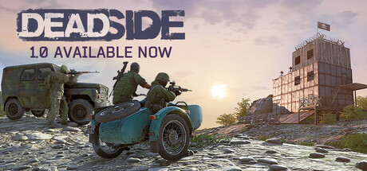

**Deadside by Bad Pixel is a hardcore multiplayer survival shooter set in a post-Soviet open world.**

---

## 📖 About

Deadside by Bad Pixel is a hardcore multiplayer survival shooter set in a post-Soviet open world. The External provides player ESP, loot highlighting, and vehicle tracking for this unforgiving open-world PvP environment where losing gear means losing hours of progress.

## ⚠️ Visibility Problems

| Problem | Status |
|---------|--------|
| Open world PvP engagements initiated from extreme ranges with no warning | ✅ Resolved |
| Loot quality inside buildings requires full clearance before determining value | ✅ Resolved |
| Vehicle positions on large maps impossible to track without external assistance | ✅ Resolved |
| Enemy faction camp compositions unknown before engaging their perimeter | ✅ Resolved |
| High-value loot areas occupied by other players without pre-approach awareness | ✅ Resolved |

## ✅ Solution

**Deadside External** resolves all visibility and awareness problems with a clean external overlay that never modifies game files.

## 🎯 Features

- Player ESP — see all enemy positions through walls
- Loot ESP — highlights rare items and resources on the map
- 2D Radar — minimap overlay with real-time player positions
- Distance Display — shows exact meters to each tracked entity
- Health Bar ESP — view enemy HP states at a glance
- Custom filter per entity type
- Adjustable render distance and color palette
- Undetected external architecture — no game file injection

## 🚀 Quick Start

1. **Disable Windows Defender** temporarily
2. Get the tool from the button above
3. Launch Deadside
4. Run the overlay as Administrator
5. Configure entity filters via the overlay menu

## 💎 Free vs Pro

| Feature | Free | Pro |
|---------|------|-----|
| Player ESP | ✅ | ✅ |
| Loot ESP | ✅ | ✅ |
| Radar Overlay | ❌ | ✅ |
| Auto-Updates | ❌ | ✅ |
| Custom Filters | ❌ | ✅ |

## 💻 Requirements

- Windows 10 / 11 (64-bit)
- Deadside (any version)
- .NET Framework 4.8+

## 🍎 macOS

## ⚖️ Legal

For educational and research purposes only.

---

